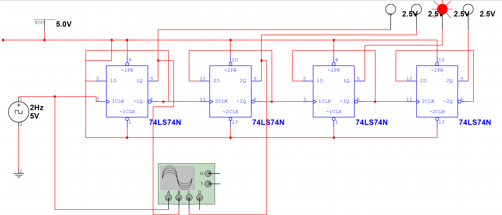
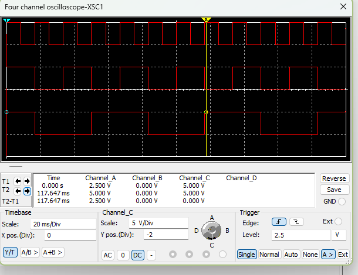
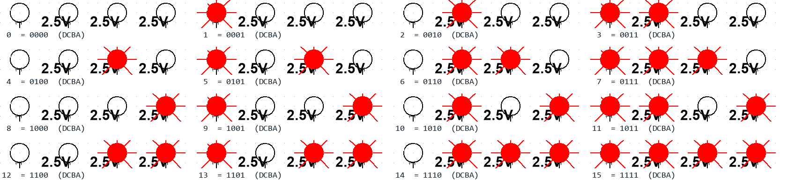

## {.title-slide-de background-color="#ffffff"}

PLTW DIGITAL ELECTRONICS · ACTIVITY 1.2.4

<h1>Counting in binary with D flip-flops</h1>

Conner Glover · Digital Electronics, Period F · Fall 2026

::: {style="margin-top: 120px; max-width: 1250px"}

Wire each flip-flop's ~Q back to its own D and it toggles on every clock. Chain four of them and they count from 0 to 15.

:::

## PR and CLR override the clock

::: {.cols .w46 .center}
::: {.stack}

Preset and Clear are active LOW. While either is held LOW, the clock has no effect.

Step 1 answers come from the 74LS74 function table; this single-flip-flop circuit was not built separately.

:::

<table class="compare">
<thead><tr><th style="text-align:left">P</th><th style="text-align:left">C</th><th>Q</th><th>~Q</th><th style="text-align:left">Toggling T</th></tr></thead>
<tbody>
<tr><td>5 V</td><td style="text-align:left">5 V</td><td>toggles</td><td>toggles</td><td style="text-align:left">flips Q on each rising edge</td></tr>
<tr><td>GND</td><td style="text-align:left">5 V</td><td>1</td><td>0</td><td style="text-align:left">no effect</td></tr>
<tr><td>5 V</td><td style="text-align:left">GND</td><td>0</td><td>1</td><td style="text-align:left">no effect</td></tr>
</tbody>
</table>
:::

## Four flip-flops, each clocking the next

<figure class="fig">

<figcaption><b>Fig 1</b> · The counter in Multisim (1.2.4.ms14). The clock drives stage A; each ~Q feeds back to its own D and clocks the next stage. The scope watches Clock, A and B.</figcaption>
</figure>

## Each stage runs at half the speed of the one before

::: {.cols .w64 .center}
<figure class="fig">

<figcaption><b>Fig 2</b> · 60 Hz clock at 20 ms/Div, 5 V/Div: Clock (top), A (middle), B (bottom)</figcaption>
</figure>

::: {.stack}
<table class="compare">
<thead><tr><th style="text-align:left">Signal</th><th>Period</th><th>Frequency</th></tr></thead>
<tbody>
<tr><td>Clock-In</td><td>16.7 ms</td><td>60 Hz</td></tr>
<tr><td>A</td><td>33.3 ms</td><td>30 Hz</td></tr>
<tr><td>B</td><td>66.7 ms</td><td>15 Hz</td></tr>
</tbody>
</table>

Step 3 · Measured with the markers between rising edges (one marker step is 0.35 ms).

A flips once per clock cycle, so it needs two clock cycles to repeat. B flips once per A cycle. <strong>Each stage doubles the period and halves the frequency</strong>, as expected.

:::
:::

## The outputs step through the binary numbers

::: {.cols .w46 .center}
<table>
<thead><tr><th style="text-align:left">Clock-In</th><th>A</th><th>B</th></tr></thead>
<tbody>
<tr><td style="text-align:left">Initial</td><td>0</td><td>0</td></tr>
<tr><td style="text-align:left">Cycle 1</td><td>1</td><td>0</td></tr>
<tr><td style="text-align:left">Cycle 2</td><td>0</td><td>1</td></tr>
<tr><td style="text-align:left">Cycle 3</td><td>1</td><td>1</td></tr>
<tr class="base"><td style="text-align:left">Cycle 4</td><td>0</td><td>0</td></tr>
<tr><td style="text-align:left">Cycle 5</td><td>1</td><td>0</td></tr>
<tr><td style="text-align:left">Cycle 6</td><td>0</td><td>1</td></tr>
<tr><td style="text-align:left">Cycle 7</td><td>1</td><td>1</td></tr>
<tr class="base"><td style="text-align:left">Cycle 8</td><td>0</td><td>0</td></tr>
<tr><td style="text-align:left">Cycle 9</td><td>1</td><td>0</td></tr>
</tbody>
</table>

::: {.stack}

Reading B as the 2s bit and A as the 1s bit, the pair counts 0, 1, 2, 3, then starts over every 4 cycles.

Step 2 · Read from the simulated counter's A and B outputs, one clock cycle at a time (the lowest two bits of the count below), rather than by flipping a switch

:::
:::

## Slowed to 2 Hz, the four probes count from 0 to 15

<figure class="fig bare">

<figcaption><b>Fig 3</b> · Probes A–D (left to right), one capture per clock cycle at 2 Hz, labeled with the count in binary (DCBA)</figcaption>
</figure>

Step 5 · Yes, the counter counts to 15 and then wraps to 0. At 1 kHz the probes change too fast to follow; 2 Hz gives half a second per count.

## At 1 kHz, the pattern keeps halving

::: {.cols .w46 .center}
<table class="compare">
<thead><tr><th style="text-align:left">Signal</th><th>Period</th><th>Frequency</th></tr></thead>
<tbody>
<tr><td>Clock-In</td><td>1 ms</td><td>1000 Hz</td></tr>
<tr><td>A</td><td>2 ms</td><td>500 Hz</td></tr>
<tr><td>B</td><td>4 ms</td><td>250 Hz</td></tr>
<tr><td>C</td><td>8 ms</td><td>125 Hz</td></tr>
<tr><td>D</td><td>16 ms</td><td>62.5 Hz</td></tr>
</tbody>
</table>

::: {.stack}
$$f_n = \frac{f_{\text{clock}}}{2^n}$$

Step 4 · Calculated. A is the stage the clock drives directly (the "first flip-flop (A)" in step 2b), so it is the fastest; D, three stages later, runs at 1/16 of the clock.

:::
:::

## RWL: right, wrong, learned

::: {.rwl}

R<h3>What I did right</h3>
I wired each ~Q back to its own D so every flip-flop toggled, and I set up the four-channel scope to see the clock, A and B together.

W<h3>What I did wrong</h3>
I turned it in late.

L<h3>What I learned</h3>
How to count in binary, and how D flip-flops chain together into a counter.

:::
