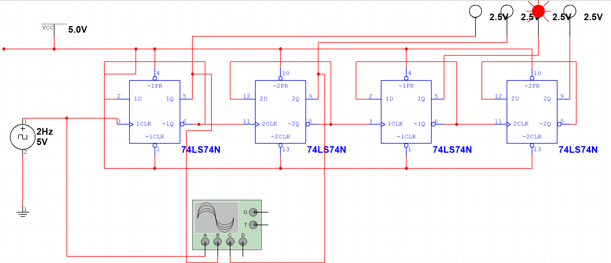
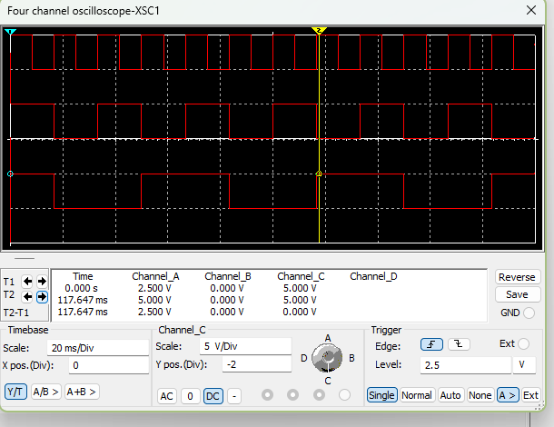
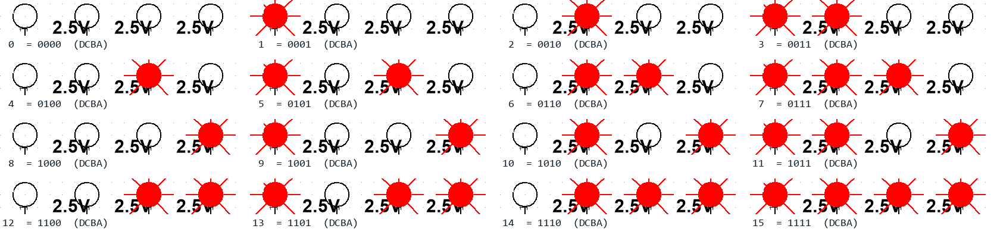

<header class="cover">
PLTW DIGITAL ELECTRONICS · ACTIVITY 1.2.4 · WRITE-UP
<h1>Counting in binary with D flip-flops</h1>

How Preset and Clear control a D flip-flop, and how chaining flip-flops makes a binary counter, measured with a four-channel oscilloscope in Multisim.

Student<b>Conner Glover</b>Class<b>Digital Electronics, Period F</b>Unit<b>1.2 Logic Design Fundamentals</b>Term<b>Fall 2026</b>

</header>

## 01Circuit

<figure>

<figcaption>Figure 1 · The counter in Multisim (1.2.4.ms14): a CLOCK_VOLTAGE drives the first 74LS74N (A). Each ~Q feeds back to its own D and clocks the next stage; Preset and Clear are tied to 5 V. The four-channel oscilloscope watches Clock-In, A and B.</figcaption>
</figure>

With D wired to ~Q, each flip-flop stores the opposite of its output on every rising clock edge, so it toggles. The first stage (A) is clocked by the clock; each later stage is clocked by the previous stage's ~Q, so it toggles when the previous stage's Q falls.

## 02Answers

1

Single D flip-flop: the effect of P, C and T on the outputs.

These answers come from the 74LS74 function table (Preset and Clear are active LOW and override the clock); the single-flip-flop circuit with P, T and C switches was not built separately.

**b.** With P and C at 5 V, both are inactive: each rising edge of T toggles Q, as in Activity 1.1.6.

**c.** P at GROUND, C at 5 V: Preset is active, so **Q = 1 and ~Q = 0**.

**d.** Toggling T has **no effect**; Q stays 1.

**e.** P at 5 V, C at GROUND: Clear is active, so **Q = 0 and ~Q = 1**.

**f.** Toggling T again has **no effect**; Q stays 0.

2

Two-bit counter: record A and B for nine cycles of Clock-In, then explain the pattern.

<table>
<thead><tr><th style="text-align:left">Clock-In</th><th>A</th><th>B</th></tr></thead>
<tbody>
<tr><td style="text-align:left">Initial values</td><td>0</td><td>0</td></tr>
<tr><td style="text-align:left">Cycle 1</td><td>1</td><td>0</td></tr>
<tr><td style="text-align:left">Cycle 2</td><td>0</td><td>1</td></tr>
<tr><td style="text-align:left">Cycle 3</td><td>1</td><td>1</td></tr>
<tr><td style="text-align:left">Cycle 4</td><td>0</td><td>0</td></tr>
<tr><td style="text-align:left">Cycle 5</td><td>1</td><td>0</td></tr>
<tr><td style="text-align:left">Cycle 6</td><td>0</td><td>1</td></tr>
<tr><td style="text-align:left">Cycle 7</td><td>1</td><td>1</td></tr>
<tr><td style="text-align:left">Cycle 8</td><td>0</td><td>0</td></tr>
<tr><td style="text-align:left">Cycle 9</td><td>1</td><td>0</td></tr>
</tbody>
</table>

Table 1 · A and B cycle by cycle, read from the simulated counter (the lowest two bits of Figure 3) rather than by flipping a switch

**c.** A changes on every cycle. B changes every other cycle, each time A goes from 1 back to 0. Reading B as the 2s bit and A as the 1s bit, the outputs count 0, 1, 2, 3 in binary and start over every four cycles.

3

Replace the switch with a 60 Hz, 50 %, 5 V CLOCK_VOLTAGE, add a four-channel oscilloscope, and measure the three periods.

<figure style="max-width: 4.4in">

<figcaption>Figure 2 · 20 ms/Div, 5 V/Div: Clock-In (top), A (middle), B (bottom)</figcaption>
</figure>

<table>
<thead><tr><th style="text-align:left">Signal</th><th>Period</th><th>Frequency</th></tr></thead>
<tbody>
<tr><td style="text-align:left">Clock-In</td><td>16.7 ms</td><td>60 Hz</td></tr>
<tr><td style="text-align:left">B</td><td>66.7 ms</td><td>15 Hz</td></tr>
<tr><td style="text-align:left">A</td><td>33.3 ms</td><td>30 Hz</td></tr>
</tbody>
</table>

Table 2 · Periods between rising edges from the markers (one marker step is 0.35 ms at 20 ms/Div)

With T1 on a clock rising edge at 0 s, the next clock rising edge fell between 16.609 and 16.955 ms, A's next rising edge between 33.218 and 33.564 ms, and B's rising edges between 49.827–50.173 ms and 116.609–116.955 ms. The scope traces were stacked with Y positions of +2, 0 and −2 divisions at 5 V/Div instead of the worksheet's 10 V/Div, so they are easier to tell apart.

**f.** Each signal has twice the period and half the frequency of the one before it: 60 Hz, 30 Hz, 15 Hz. This is expected, because each flip-flop toggles once per cycle of its input, so it takes two input cycles to make one output cycle.

4

Find the period and frequency of A, B, C and D for the 4-bit counter with a 1 kHz clock.

Each stage halves the frequency, so $f_n = f_{\text{clock}} / 2^n$. A is the stage the clock drives directly.

<table>
<thead><tr><th style="text-align:left">Signal</th><th>Period</th><th>Frequency</th></tr></thead>
<tbody>
<tr><td style="text-align:left">Clock-In</td><td>1 ms</td><td>1000 Hz</td></tr>
<tr><td style="text-align:left">D</td><td>16 ms</td><td>62.5 Hz</td></tr>
<tr><td style="text-align:left">C</td><td>8 ms</td><td>125 Hz</td></tr>
<tr><td style="text-align:left">B</td><td>4 ms</td><td>250 Hz</td></tr>
<tr><td style="text-align:left">A</td><td>2 ms</td><td>500 Hz</td></tr>
</tbody>
</table>

5

Slow the clock so the count is visible. Can you count to 15? What clock frequency worked best?

<figure>

<figcaption>Figure 3 · Probes A–D (left to right) captured once per clock cycle at 2 Hz, labeled with the count in binary (DCBA)</figcaption>
</figure>

**a.** Yes. The probes step through every value from 0000 to 1111 (0 to 15) and then wrap back to 0000.

**b.** 2 Hz, which gives half a second per count: slow enough to read each number and fast enough to see the whole count in 8 seconds.

## 03Sources

- PLTW Activity 1.2.4 *Introduction to Sequential Logic Design: Counters*.
- `1.2.4.ms14`, built in Multisim on 2026-09-25 from the flip-flop counter in Conner's 1.2.5 circuit, with the 555 timer replaced by a CLOCK_VOLTAGE.
- The 74LS74 function table (Preset and Clear behavior, step 1).
