---

# 1.2.7 Understanding Digital Design: Random Number Generator

Conner Glover · Digital Electronics, Period F · Fall 2026

---

# One circuit, three sections, one rolling die

The project: build each section in Multisim, test it on its own, then connect all three. Repeat the build in TinkerCAD.

---

# The soldered 1.1.9 board is the same design in hardware

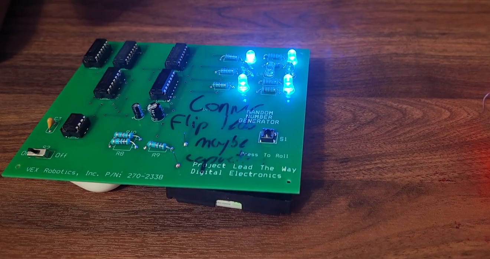

Kit. PLTW / VEX Robotics Random Number Generator, P/N 270-2338.

Parts. A 555 timer, 74LS logic ICs, R8–R10 timing resistors, the timing and "roll" capacitors, seven LEDs in a die pattern, the Press To Roll button (S1) and a power switch (S2).

Video. In the 9.5 s clip the button is pressed and the die rolls and lands on a new face.

The first build had every LED in backwards; they were desoldered and replaced. L6 didn't survive the rework (from the 1.1.9 slides).

---

# In Multisim, the complete generator builds and simulates

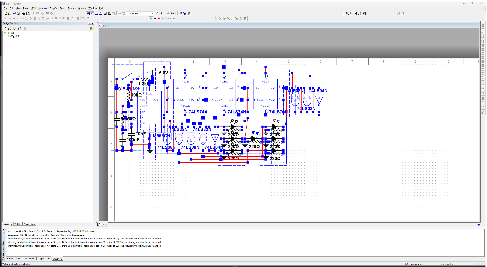

Fig 2 · Screenshot of my 1.2.7 Multisim file, taken 26 Sep 2026 while the simulation ran (status bar: Simulating... Tran: 31.929 s). The SPICE netlist check reports 0 errors.

---

# Analog section: the 555 timer controls the roll

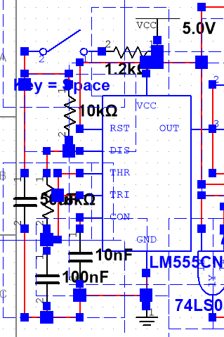

The Space key toggles switch S1. Closing it charges the 50 µF roll capacitor through 1.2 kΩ. That capacitor feeds RA, so while it's charged the 555 runs as a normal astable clock (RA = 10 kΩ, RB = 18 kΩ, C = 100 nF):

Opening S1 cuts the charging path. The 50 µF capacitor drains through RA and RB, the timing capacitor charges more and more slowly, and the clock slows down and stops, like a die tumbling to a stop.

---

# Sequential section: three flip-flops count from 1 to 6

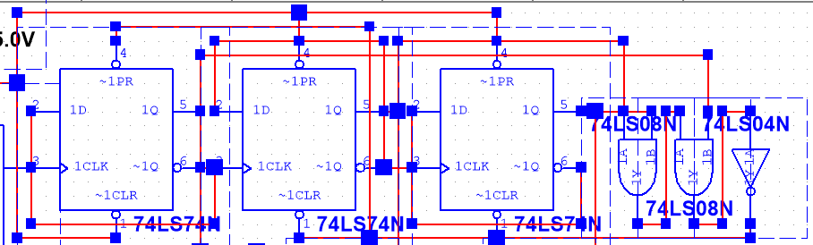

Each flip-flop has D tied to its own ~Q, so it toggles on every clock edge. The 555 clocks C (the 1s bit), C's ~Q clocks B, and B's ~Q clocks A: a 3-bit ripple counter.

When the count reaches 111, the two AND gates go HIGH and the inverter pulls the async inputs LOW: it clears A and B and presets C. The count jumps back to 001, so it only shows 1–6.

---

# Combinational section: four equations light seven LEDs

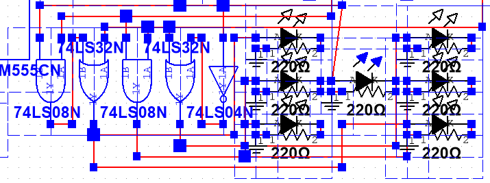

Opposite LEDs always light together, so four signals are enough:

Read from the exported netlist of my circuit: exactly two AND gates, two OR gates and one inverter. Each LED has a 220 Ω resistor to ground.

---

# Calculated outputs give the six die faces

000 would light L3 and L7, which looks like a 2. 111 would light all seven LEDs, which isn't a die face.

It doesn't matter: the counter goes 001 to 110 and resets at 111, so neither is a sustained normal count. Brief transition patterns can occur (question 1d).

Expected pattern for each count ABC, worked out from the gate equations · Layout matches the worksheet: L1 L7 top, L2 L4 L6 middle, L3 L5 bottom

---

# The Multisim recording rolls, then holds 4 and 2

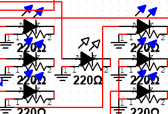

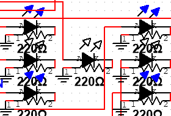

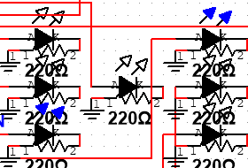

S1 closes and opens twice. After it opens, the LED pattern keeps changing before holding one face.

The 14.07-second recording contains stable patterns for faces 1–6. Some transition frames show mixed patterns. Times are GIF playback positions, not measured circuit timing. The animated original is supplied separately.

---

# The finished TinkerCAD circuit connects all three sections

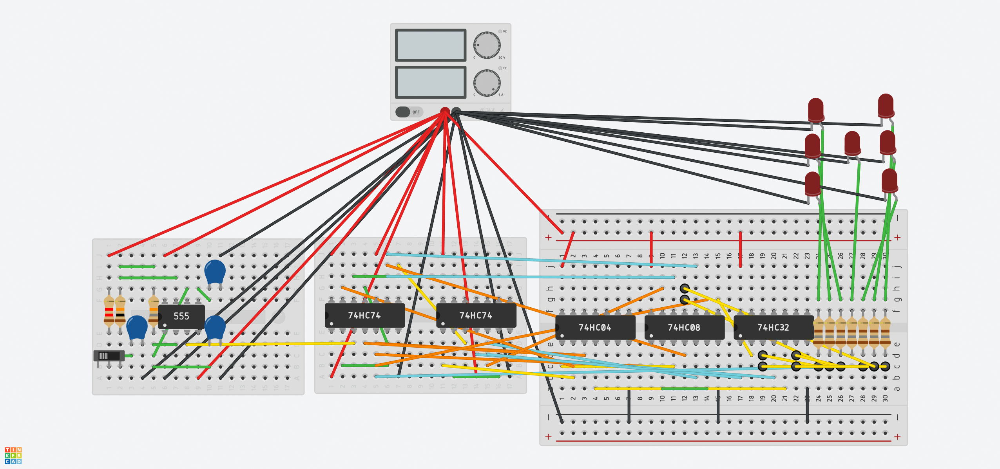

Fig 7 · Finished TinkerCAD build supplied by Conner. The power supply reads OFF, its displays are blank, and the LEDs are unlit. This image documents the build, not a running test.

---

# TinkerCAD uses the same clock, counter and decoder design

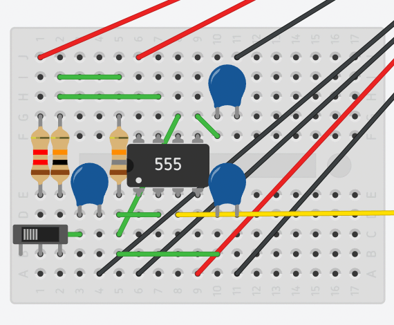

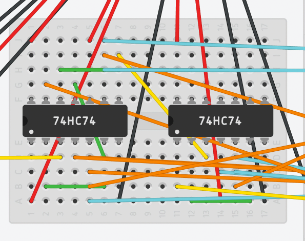

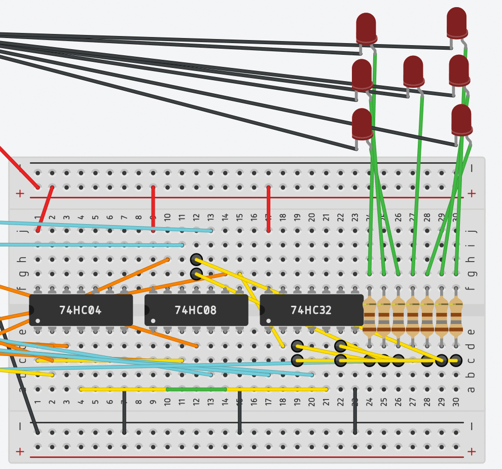

The 555 timer, resistors and capacitors form the clock. The slide switch controls the roll circuit.

Two 74HC74 packages provide the flip-flops for the three-bit counter. The design repeats counts 001 through 110.

The 74HC04, 74HC08 and 74HC32 decode the count. Seven resistors limit LED current; seven LEDs form the die face.

TinkerCAD uses 74HC packages; Multisim uses 74LS parts. The supplied GIF now documents the powered circuit. Component values and exact pin connections are not verified by the overview alone.

---

# The TinkerCAD recording shows changing die faces

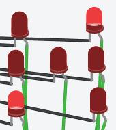

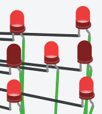

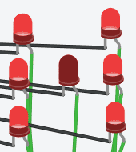

The 22.8-second GIF shows the powered circuit changing its LED pattern. The last frame shows a 6.

The supply reads 5.00 V. These are sampled frames, not a complete count-sequence test. Import tinkercad-working.gif beside the PDF to keep the animation.

---

# The clock sets the speed; the counter and decoder form the die

The soldered board, Multisim circuit and TinkerCAD build use the same three sections: a 555 clock, a counter and a decoder.

The counter runs hundreds of times a second, far faster than anyone can follow, so where it stops is effectively random, even though the circuit is fully predictable.

The 50 µF roll capacitor is what makes it feel like a real die: the count slows down before it stops instead of freezing instantly.

---

# RWL: right, wrong, learned

I successfully created the random number generator in Multisim and TinkerCAD. I made my Multisim build super compact.

TinkerCAD was late. My Multisim build might be a bit hard to read.

I learned how to use breadboards a bit better. I hate breadboards.
