# AOI Logic Implementation

AOI
Logic
Implementation
2.1.3 · Conner Glover
Digital Electronics
Three inputs.
One verified logic function.

[Conceptual circuit illustration; see presentation.html]

0000
0011
0100
0111
1001
1011
1101
1110

Calculated F1 outputs · ABC at left, output at right · 0 = LOW, 1 = HIGH

---

# F1 is HIGH in five of eight states

$F_1=A\overline C+\overline A C+A\overline B C$

Expected outputs are calculated. Multisim outputs are observed.

| A B C | Calculated F1 | Multisim |
|---|---|---|
| 0 0 0 | 0 | 0 |
| 0 0 1 | 1 | 1 |
| 0 1 0 | 0 | 0 |
| 0 1 1 | 1 | 1 |
| 1 0 0 | 1 | 1 |
| 1 0 1 | 1 | 1 |
| 1 1 0 | 1 | 1 |
| 1 1 1 | 0 | 0 |

Stable recording frames only, not output-voltage measurements. 0 = LOW; 1 = HIGH.

---

# Multisim implements an equivalent form

[Conceptual circuit illustration; see presentation.html]
Functional trace redrawn from the clearer recording.
The 2.5 V label is not an output measurement.

$F_1=\overline{AC}(A+C)+AC\overline B$

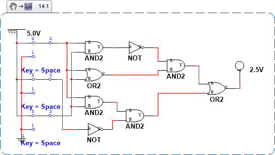

---

# All eight stable Multisim states match

000
LOW
7.33 s

001
HIGH
3.33 s

010
LOW
5.33 s

011
HIGH
1.53 s

100
HIGH
6.00 s

101
HIGH
2.93 s

110
HIGH
4.33 s

111
LOW
0.00 s

Real crops from multisim.gif · A / B / C top to bottom · playback times, not circuit timing.
Brief transition frames excluded from the steady-state comparison.

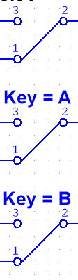
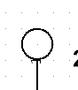
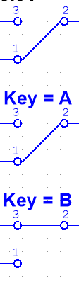
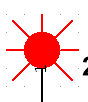
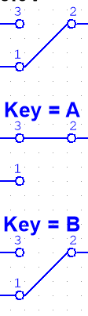

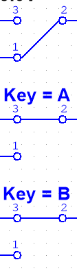

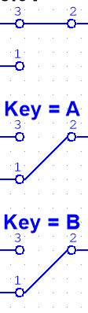

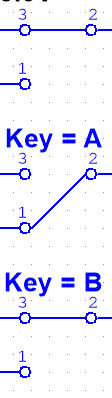

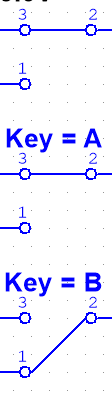

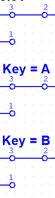

---

# TinkerCAD uses NOT, OR and AND packages

74HC04 · 74HC32 · 74HC08. Power is OFF in this still: wiring evidence, not an output test.
Conner’s alternative
He reports two ANDs, one OR and one NOT instead of the intended three ANDs and two NOTs. These counts are student-reported, not independently traced.

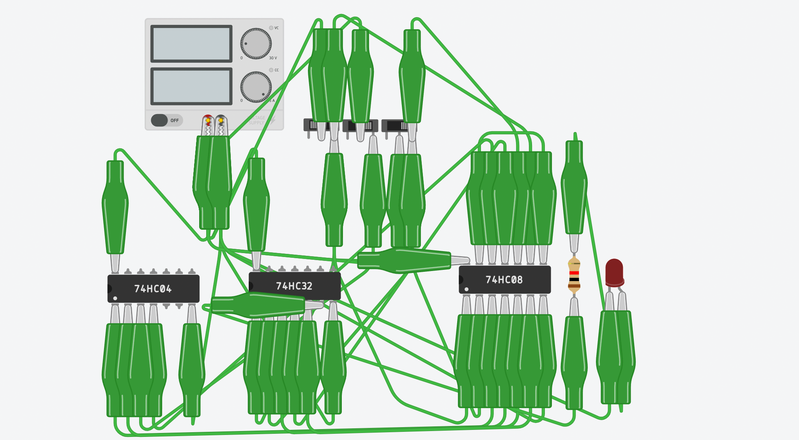

---

# The TinkerCAD circuit operates correctly

Bright LED1.33 s · 3.04 mA

Dark LED2.67 s · 52.7 µA

Supply displays 5.00 V in both frames; currents are supply readouts.
Correct operation confirmed by the teacher.

Teacher-verified, as reported by Conner.

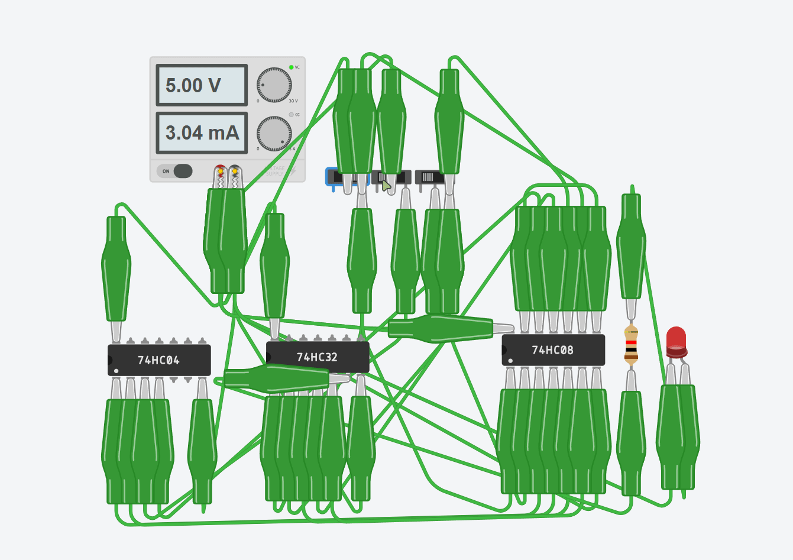
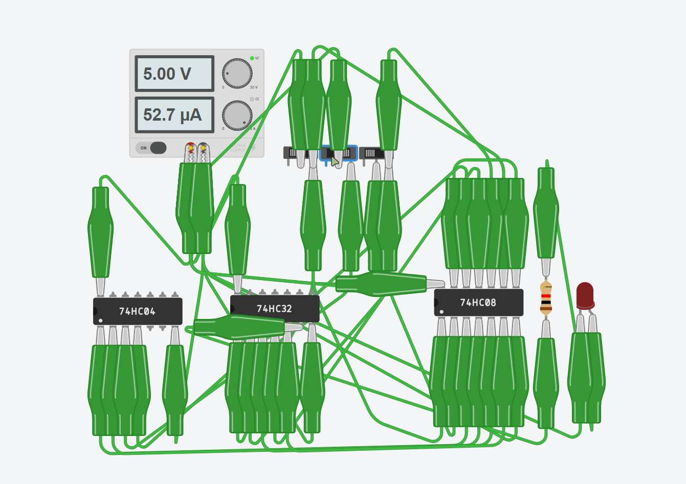

---

# The physical circuit is built on the protoboard

Overhead: packages, jumpers and red LED

Oblique: wire routing and placement

Three DIP packages, jumper connections and a red output LED form the physical build.

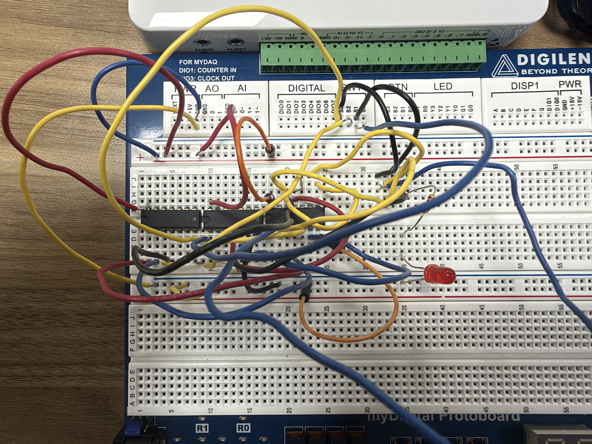
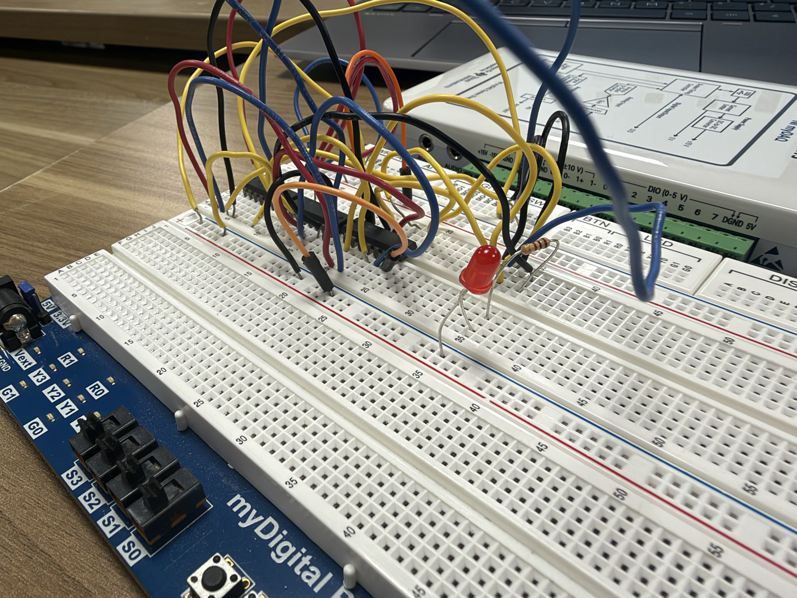

---

# The physical build operates correctly

irl.mp4 · 7.25 s playback. Correct physical operation confirmed by the teacher.

Teacher-verified, as reported by Conner.

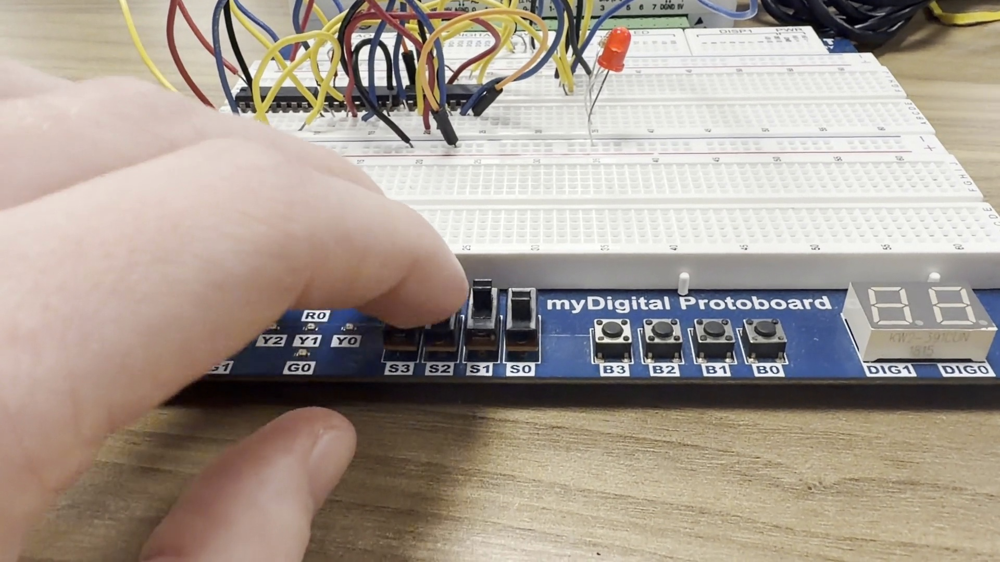

---

# All three implementations were completed correctly

Multisim
Correct
TinkerCAD
Correct
Physical build
Correct

The teacher reviewed the work and confirmed that everything was correct.
Teacher-verified, as reported by Conner.

---

# RWL · Conner’s reflection

RRight
Completed it rather fast despite missing a work day. Built it in TinkerCAD quickly. Used my TinkerCAD to do the physical build.
Took a different approach than the intended approach: instead of three ANDs and two NOTs, it’s two ANDs, one OR, and one NOT.

WWrong
Built the TinkerCAD with only alligator clips.

LLearned
Different gate arrangements can produce the same output. I can use a different design as long as it matches the truth table.

Right/Wrong supplied by Conner. Learned proposed with AI assistance and approved by Conner.

