##  {.logic-atlas .night background-image="assets/logic-night.svg" background-size="cover" background-color="#0f1a24"}

<!-- School contributors
Generated by: AI
Completed: Not Completed
-->

<!-- Slide 0001 | Review: verified | Native AI-authored source; supplied evidence visually reviewed. -->

<h1 class="cover-title">AOI</h1>
Logic Implementation

2.1.3 · Conner Glover Digital Electronics

Three inputs. One verified logic function.

<svg xmlns="http://www.w3.org/2000/svg" viewBox="0 0 1000 650" role="img" aria-label="Conceptual F1 SOP gate network with three product terms and final OR"><path d="M360 35H435.0A75.0 55.0 0 0 1 435.0 145H360Z" fill="#172633" stroke="#59b9af" stroke-width="4"/><text x="75" y="75" font-family="DE Text" font-size="38" fill="#f2efe6" text-anchor="start">A</text><path d="M115 65H360" fill="none" stroke="#e0502a" stroke-width="4" stroke-linejoin="round"/><text x="75" y="125" font-family="DE Text" font-size="38" fill="#f2efe6" text-anchor="start">C</text><path d="M115 115H200" fill="none" stroke="#e0502a" stroke-width="4" stroke-linejoin="round"/><path d="M200 89L246 115L200 141Z" fill="#172633" stroke="#f2b134" stroke-width="4"/><circle cx="254" cy="115" r="8" fill="#0f1a24" stroke="#f2b134" stroke-width="4"/><path d="M262 115H360" fill="none" stroke="#e0502a" stroke-width="4" stroke-linejoin="round"/><text x="425" y="100.0" font-family="DE Text" font-size="24" fill="#b7dcd6" text-anchor="middle">AND</text><path d="M360 235H435.0A75.0 55.0 0 0 1 435.0 345H360Z" fill="#172633" stroke="#59b9af" stroke-width="4"/><text x="75" y="275" font-family="DE Text" font-size="38" fill="#f2efe6" text-anchor="start">A</text><path d="M115 265H200" fill="none" stroke="#e0502a" stroke-width="4" stroke-linejoin="round"/><path d="M200 239L246 265L200 291Z" fill="#172633" stroke="#f2b134" stroke-width="4"/><circle cx="254" cy="265" r="8" fill="#0f1a24" stroke="#f2b134" stroke-width="4"/><path d="M262 265H360" fill="none" stroke="#e0502a" stroke-width="4" stroke-linejoin="round"/><text x="75" y="325" font-family="DE Text" font-size="38" fill="#f2efe6" text-anchor="start">C</text><path d="M115 315H360" fill="none" stroke="#e0502a" stroke-width="4" stroke-linejoin="round"/><text x="425" y="300.0" font-family="DE Text" font-size="24" fill="#b7dcd6" text-anchor="middle">AND</text><path d="M360 435H435.0A75.0 65.0 0 0 1 435.0 565H360Z" fill="#172633" stroke="#59b9af" stroke-width="4"/><text x="75" y="475" font-family="DE Text" font-size="38" fill="#f2efe6" text-anchor="start">A</text><path d="M115 465H360" fill="none" stroke="#e0502a" stroke-width="4" stroke-linejoin="round"/><text x="75" y="510" font-family="DE Text" font-size="38" fill="#f2efe6" text-anchor="start">B</text><path d="M115 500H200" fill="none" stroke="#e0502a" stroke-width="4" stroke-linejoin="round"/><path d="M200 474L246 500L200 526Z" fill="#172633" stroke="#f2b134" stroke-width="4"/><circle cx="254" cy="500" r="8" fill="#0f1a24" stroke="#f2b134" stroke-width="4"/><path d="M262 500H360" fill="none" stroke="#e0502a" stroke-width="4" stroke-linejoin="round"/><text x="75" y="545" font-family="DE Text" font-size="38" fill="#f2efe6" text-anchor="start">C</text><path d="M115 535H360" fill="none" stroke="#e0502a" stroke-width="4" stroke-linejoin="round"/><text x="425" y="510.0" font-family="DE Text" font-size="24" fill="#b7dcd6" text-anchor="middle">AND</text><path d="M735 180Q850 180 935 300Q850 420 735 420Q795 300 735 180Z" fill="#172633" stroke="#59b9af" stroke-width="4"/><path d="M510 90H625V235H757" fill="none" stroke="#e0502a" stroke-width="4" stroke-linejoin="round"/><path d="M510 290H768" fill="none" stroke="#e0502a" stroke-width="4" stroke-linejoin="round"/><path d="M510 500H655V365H757" fill="none" stroke="#e0502a" stroke-width="4" stroke-linejoin="round"/><text x="833" y="310" font-family="DE Text" font-size="28" fill="#b7dcd6" text-anchor="middle">OR</text><path d="M935 300H980" fill="none" stroke="#e0502a" stroke-width="4" stroke-linejoin="round"/><text x="956" y="270" font-family="DE Text" font-size="34" fill="#f2b134" text-anchor="start">F1</text><text x="540" y="53" font-family="DE Text" font-size="28" fill="#b7ccd2" text-anchor="start">A · NOT(C)</text><text x="540" y="335" font-family="DE Text" font-size="28" fill="#b7ccd2" text-anchor="start">NOT(A) · C</text><text x="540" y="555" font-family="DE Text" font-size="28" fill="#b7ccd2" text-anchor="start">A · NOT(B) · C</text><text x="75" y="630" font-family="DE Text" font-size="29" fill="#b7ccd2" text-anchor="start">Conceptual F1 network · not observed wiring</text></svg>

000<b class="low">0</b>

001<b class="">1</b>

010<b class="low">0</b>

011<b class="">1</b>

100<b class="">1</b>

101<b class="">1</b>

110<b class="">1</b>

111<b class="low">0</b>

Calculated F1 outputs · ABC at left, output at right · 0 = LOW, 1 = HIGH

Conner Glover · Digital Electronics · 2.1.301 / 10

## F1 is HIGH in five of eight states {.logic-atlas background-image="assets/logic-paper.svg" background-size="cover" background-color="#f2efe6"}

<!-- Slide 0002 | Review: verified | Native AI-authored source; supplied evidence visually reviewed. -->

The target is the worksheet’s sum-of-products expression.

$F_1=A\overline C+\overline A C+A\overline B C$

Expected outputs are calculated. Multisim outputs are observed.

0 = LOW · 1 = HIGH

<table class="truth-table"><thead><tr><th>A B C</th><th>Calculated F1</th><th>Multisim</th></tr></thead><tbody><tr><td>0 0 0</td><td class="calc">0</td><td class="observed">0</td></tr><tr><td>0 0 1</td><td class="calc">1</td><td class="observed">1</td></tr><tr><td>0 1 0</td><td class="calc">0</td><td class="observed">0</td></tr><tr><td>0 1 1</td><td class="calc">1</td><td class="observed">1</td></tr><tr><td>1 0 0</td><td class="calc">1</td><td class="observed">1</td></tr><tr><td>1 0 1</td><td class="calc">1</td><td class="observed">1</td></tr><tr><td>1 1 0</td><td class="calc">1</td><td class="observed">1</td></tr><tr><td>1 1 1</td><td class="calc">0</td><td class="observed">0</td></tr></tbody></table>

Stable source-recording frames only; not measured output voltages.

Conner Glover · Digital Electronics · 2.1.302 / 10

## Multisim implements an equivalent form {.logic-atlas .night background-image="assets/logic-night.svg" background-size="cover" background-color="#0f1a24"}

<!-- Slide 0003 | Review: verified | Native AI-authored source; supplied evidence visually reviewed. -->

<svg xmlns="http://www.w3.org/2000/svg" viewBox="0 0 1100 650" role="img" aria-label="Functional trace: NOT(AC)(A+C) plus AC NOT(B)"><text x="20" y="65" font-family="DE Text" font-size="38" fill="#f2efe6" text-anchor="start">A, C</text><rect x="170" y="85" width="160" height="100" rx="14" fill="#172633" stroke="#0e7f7b" stroke-width="3"/><text x="250.0" y="147.0" font-family="DE Text" font-size="35" fill="#f2efe6" text-anchor="middle">AND</text><text x="250" y="65" font-family="DE Text" font-size="30" fill="#b7ccd2" text-anchor="middle">AC</text><path d="M75 85V120H170" fill="none" stroke="#e0502a" stroke-width="4" stroke-linejoin="round"/><path d="M330 135H390V90H430" fill="none" stroke="#e0502a" stroke-width="4" stroke-linejoin="round"/><rect x="430" y="40" width="150" height="100" rx="14" fill="#172633" stroke="#f2b134" stroke-width="3"/><text x="505.0" y="102.0" font-family="DE Text" font-size="35" fill="#f2efe6" text-anchor="middle">NOT</text><path d="M580 90H650V190H700" fill="none" stroke="#e0502a" stroke-width="4" stroke-linejoin="round"/><rect x="170" y="260" width="160" height="100" rx="14" fill="#172633" stroke="#0e7f7b" stroke-width="3"/><text x="250.0" y="322.0" font-family="DE Text" font-size="35" fill="#f2efe6" text-anchor="middle">OR</text><text x="250" y="395" font-family="DE Text" font-size="30" fill="#b7ccd2" text-anchor="middle">A + C</text><path d="M75 220V310H170" fill="none" stroke="#e0502a" stroke-width="4" stroke-linejoin="round"/><text x="20" y="220" font-family="DE Text" font-size="38" fill="#f2efe6" text-anchor="start">A, C</text><path d="M330 310H650V250H700" fill="none" stroke="#e0502a" stroke-width="4" stroke-linejoin="round"/><rect x="700" y="170" width="160" height="100" rx="14" fill="#172633" stroke="#0e7f7b" stroke-width="3"/><text x="780.0" y="232.0" font-family="DE Text" font-size="35" fill="#f2efe6" text-anchor="middle">AND</text><path d="M390 135V495H700" fill="none" stroke="#e0502a" stroke-width="4" stroke-linejoin="round"/><circle cx="390" cy="135" r="7" fill="#e0502a"/><text x="340" y="460" font-family="DE Text" font-size="29" fill="#b7ccd2" text-anchor="start">AC</text><text x="20" y="580" font-family="DE Text" font-size="38" fill="#f2efe6" text-anchor="start">B</text><path d="M60 570H430" fill="none" stroke="#e0502a" stroke-width="4" stroke-linejoin="round"/><rect x="430" y="520" width="150" height="100" rx="14" fill="#172633" stroke="#f2b134" stroke-width="3"/><text x="505.0" y="582.0" font-family="DE Text" font-size="35" fill="#f2efe6" text-anchor="middle">NOT</text><path d="M580 570H650V555H700" fill="none" stroke="#e0502a" stroke-width="4" stroke-linejoin="round"/><rect x="700" y="470" width="160" height="100" rx="14" fill="#172633" stroke="#0e7f7b" stroke-width="3"/><text x="780.0" y="532.0" font-family="DE Text" font-size="35" fill="#f2efe6" text-anchor="middle">AND</text><path d="M860 220H915V325H950" fill="none" stroke="#e0502a" stroke-width="4" stroke-linejoin="round"/><path d="M860 520H915V385H950" fill="none" stroke="#e0502a" stroke-width="4" stroke-linejoin="round"/><rect x="950" y="305" width="130" height="100" rx="14" fill="#172633" stroke="#0e7f7b" stroke-width="3"/><text x="1015.0" y="367.0" font-family="DE Text" font-size="35" fill="#f2efe6" text-anchor="middle">OR</text><text x="990" y="450" font-family="DE Text" font-size="38" fill="#f2b134" text-anchor="start">F1</text></svg>

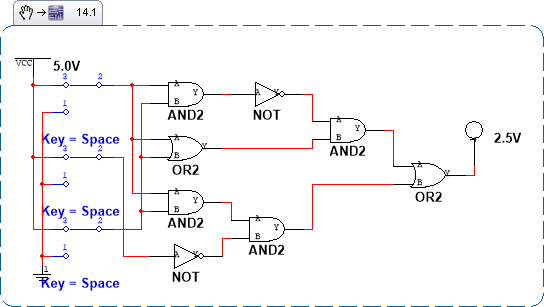
Functional trace redrawn from the clearer recording.

The 2.5 V label is not an output measurement.

$F_1=\overline{AC}(A+C)+AC\overline B$

Conner Glover · Digital Electronics · 2.1.303 / 10

## All eight stable Multisim states match {.logic-atlas .night background-image="assets/logic-night.svg" background-size="cover" background-color="#0f1a24"}

<!-- Slide 0004 | Review: verified | Native AI-authored source; supplied evidence visually reviewed. -->

000
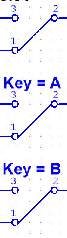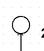
LOW

7.33 s

001
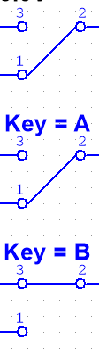
HIGH

3.33 s

010
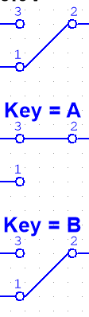
LOW

5.33 s

011
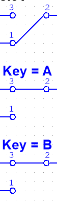
HIGH

1.53 s

100
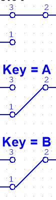
HIGH

6.00 s

101
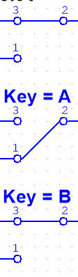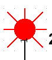
HIGH

2.93 s

110
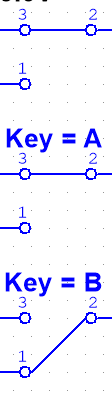
HIGH

4.33 s

111
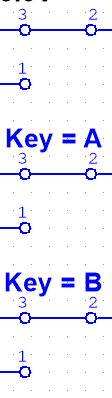
LOW

0.00 s

Real crops from multisim.gif · A / B / C top to bottom · playback times, not circuit timing.

Brief transition frames excluded from the steady-state comparison.

Conner Glover · Digital Electronics · 2.1.304 / 10

## TinkerCAD uses NOT, OR and AND packages {.logic-atlas background-image="assets/logic-paper.svg" background-size="cover" background-color="#f2efe6"}

<!-- Slide 0005 | Review: verified | Native AI-authored source; supplied evidence visually reviewed. -->

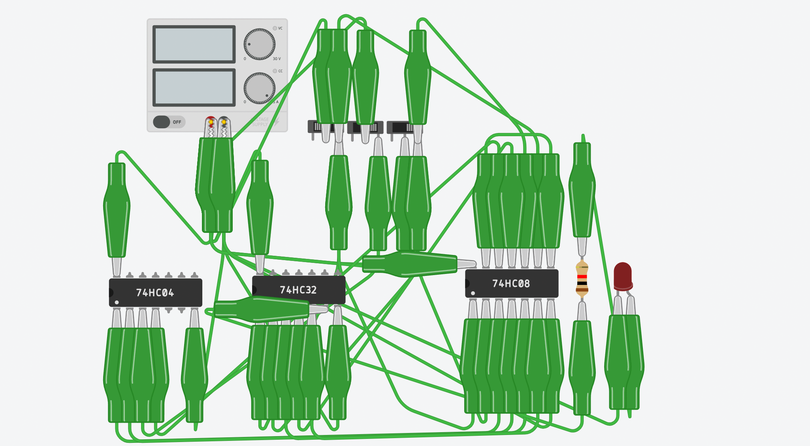
74HC04 · 74HC32 · 74HC08. Power is OFF in this still: wiring evidence, not an output test.

<h3>Conner’s alternative</h3>
He reports two ANDs, one OR and one NOT instead of the intended three ANDs and two NOTs. These counts are student-reported, not independently traced.

Conner Glover · Digital Electronics · 2.1.305 / 10

## The TinkerCAD LED changes during switching {.logic-atlas background-image="assets/logic-paper.svg" background-size="cover" background-color="#f2efe6"}

<!-- Slide 0006 | Review: verified | Native AI-authored source; supplied evidence visually reviewed. -->

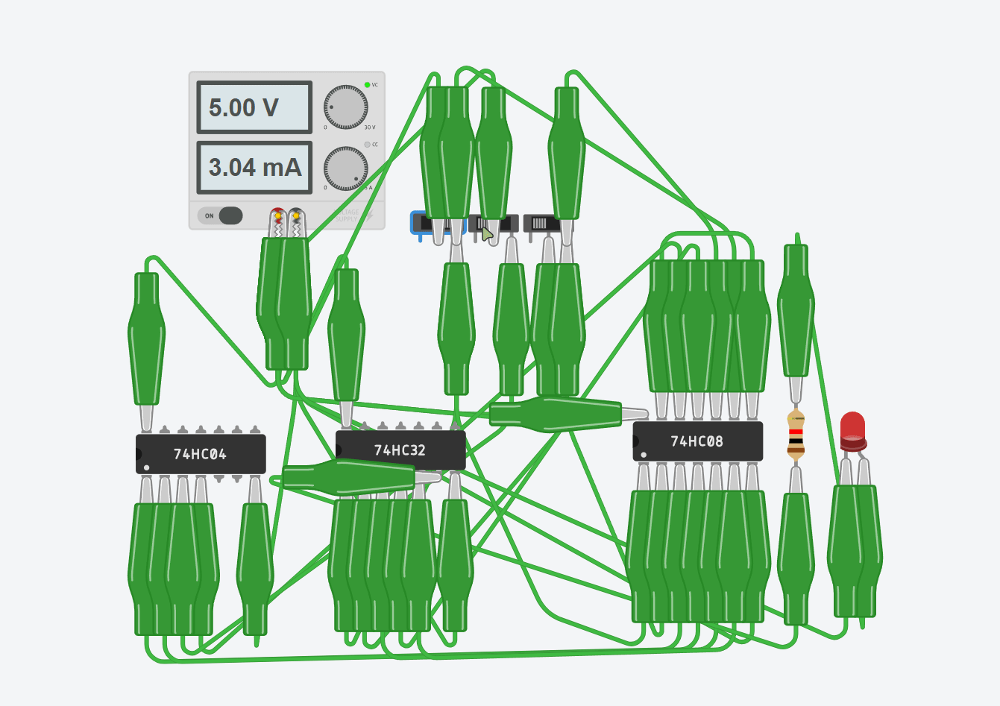
<strong>Bright LED</strong>1.33 s · 3.04 mA

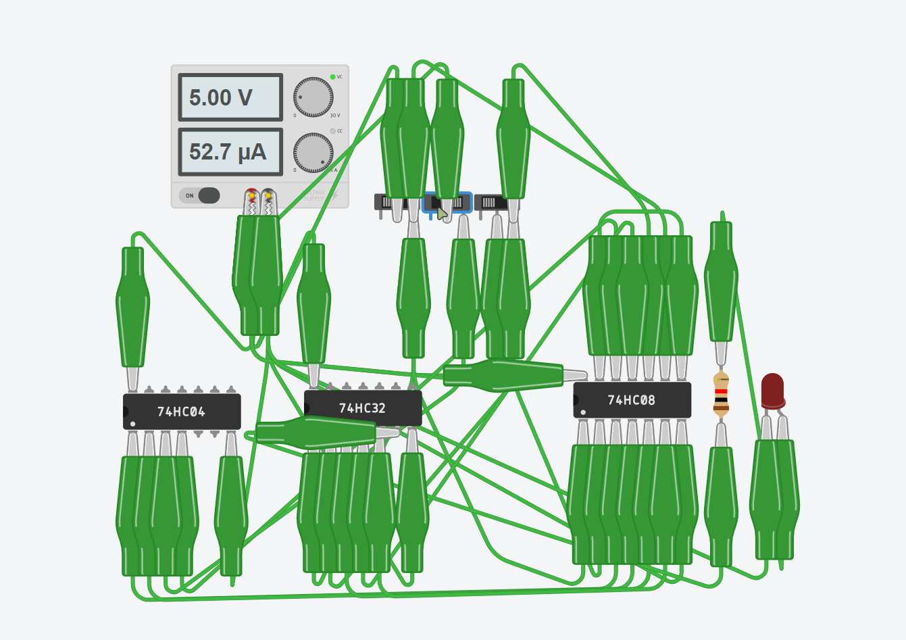
<strong>Dark LED</strong>2.67 s · 52.7 µA

Supply displays 5.00 V in both frames; currents are supply readouts.

A/B/C mapping is not established. A complete eight-state match remains unverified.

Conner Glover · Digital Electronics · 2.1.306 / 10

## The physical circuit is built on the protoboard {.logic-atlas background-image="assets/logic-paper.svg" background-size="cover" background-color="#f2efe6"}

<!-- Slide 0007 | Review: verified | Native AI-authored source; supplied evidence visually reviewed. -->

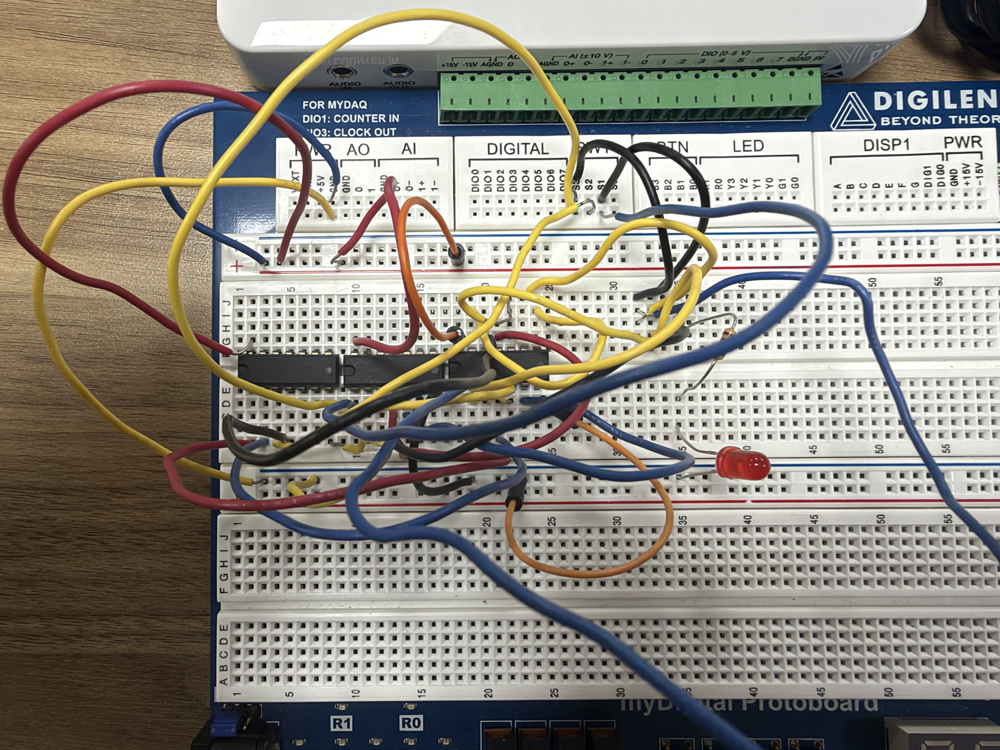
Overhead: packages, jumpers and red LED

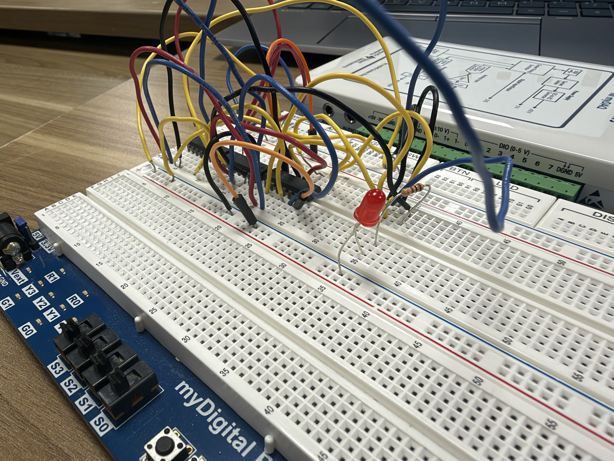
Oblique: wire routing and placement

Three DIP packages are visible; IC markings and a complete netlist are not readable.

Conner Glover · Digital Electronics · 2.1.307 / 10

## The physical recording shows manual switching {.logic-atlas .night background-image="assets/logic-night.svg" background-size="cover" background-color="#0f1a24"}

<!-- Slide 0008 | Review: verified | Native AI-authored source; supplied evidence visually reviewed. -->

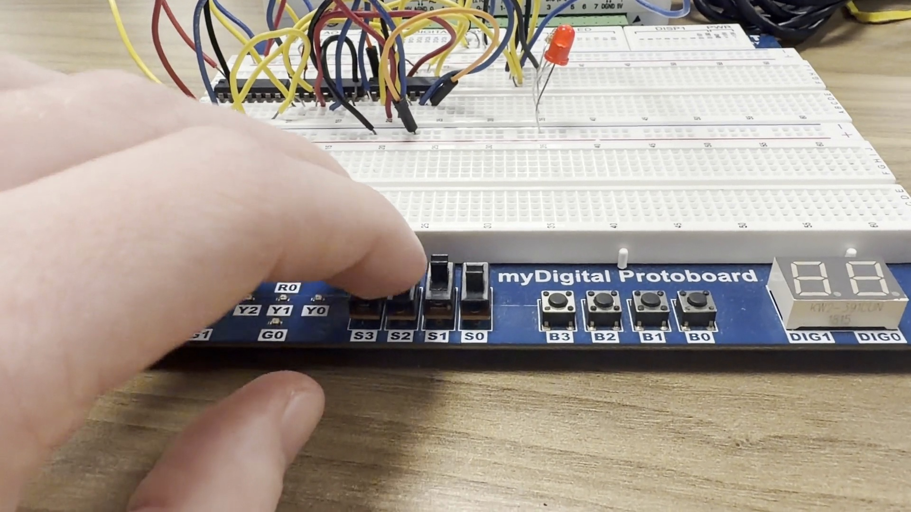
irl.mp4 · 7.25 s playback. The hand obscures switch positions; a complete A/B/C-to-output sequence is not established.

Conner Glover · Digital Electronics · 2.1.308 / 10

## Only Multisim has a complete verified comparison {.logic-atlas .night .teal background-image="assets/logic-teal.svg" background-size="cover" background-color="#085b60"}

<!-- Slide 0009 | Review: verified | Native AI-authored source; supplied evidence visually reviewed. -->

000001010011100101110111

<h3><a href="assets/multisim.gif">Multisim</a></h3>
Eight stable states match

01011110

<h3><a href="assets/tinkercad.gif">TinkerCAD</a></h3>
Wiring and LED changes

????????

<h3><a href="assets/irl.mp4">Physical build</a></h3>
Construction and switching

????????

? = no verified row mapping, not a failed state. Still needed: labeled A/B/C maps and eight output states for both builds.

Conner Glover · Digital Electronics · 2.1.309 / 10

## RWL · Conner’s reflection {.logic-atlas background-image="assets/logic-paper.svg" background-size="cover" background-color="#f2efe6"}

<!-- Slide 0010 | Review: verified | Native AI-authored source; supplied evidence visually reviewed. -->

R<h3>Right</h3>
Completed it rather fast despite missing a work day. Built it in TinkerCAD quickly. Used my TinkerCAD to do the physical build.

Took a different approach than the intended approach: instead of three ANDs and two NOTs, it’s two ANDs, one OR, and one NOT.

W<h3>Wrong</h3>
Built the TinkerCAD with only alligator clips.

L<h3>Learned</h3>
Different gate arrangements can produce the same output. I can use a different design as long as it matches the truth table.

Right/Wrong supplied by Conner. Learned proposed with AI assistance and approved by Conner.

Conner Glover · Digital Electronics · 2.1.310 / 10

