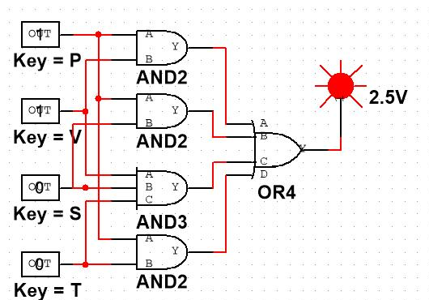
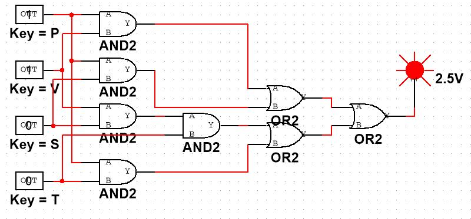
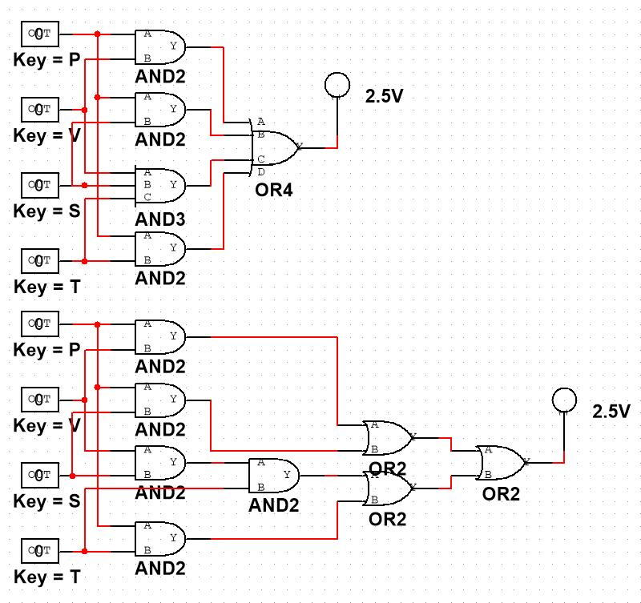
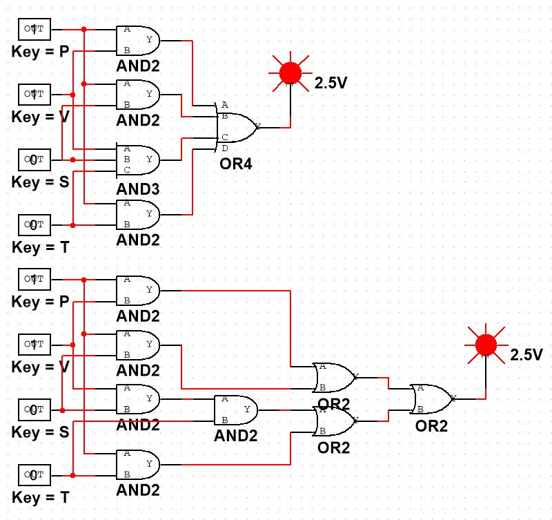
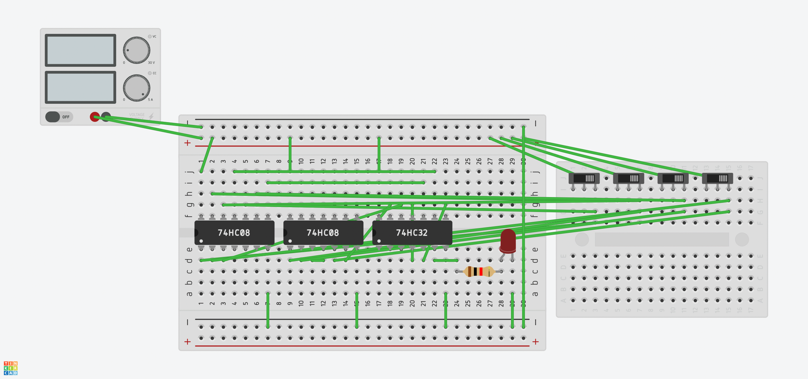
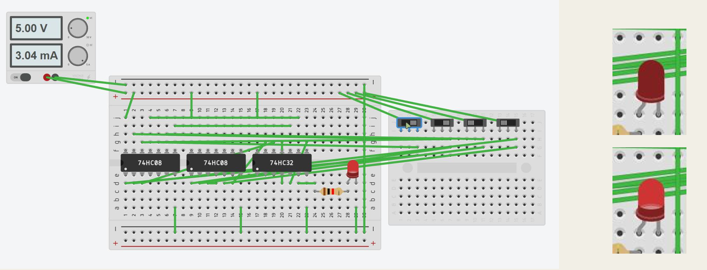
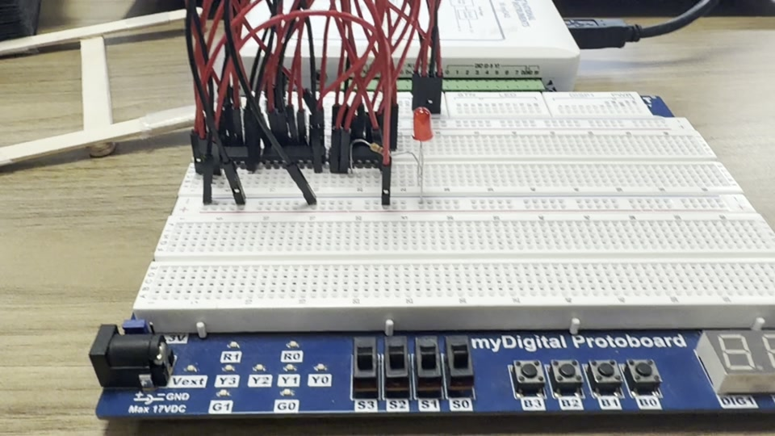

## The president breaks a tie. {background-color="#0f1a24"}

<!-- Slide 0001 | Review: verified | PDF page 1 | Image: pages/majority-vote-page-0001.png -->

<!-- School contributors
Generated by: AI
Completed: Not Completed
-->
<!-- Presentation assembly, theory and diagrams: AI. Source media and final RWL: Conner. -->

Majority Vote

2.1.6 AOI Logic Design · Conner Glover · Digital Electronics

::: {.cover-diagram}

:::

Conceptual logic: any presidential pair, or all three other voters.

## The board needs one electronic decision.

<!-- Slide 0002 | Review: verified | PDF page 2 | Image: pages/majority-vote-page-0002.png -->

::: {.brief}
::: {}
<h3>Design brief</h3>

<strong>Client:</strong> Company board of directors <strong>Designer:</strong> Conner Glover

<strong>Problem:</strong> Display pass/fail from four yes/no votes.

<strong>Design:</strong> Design, simulate and build an AOI voting circuit.

:::
::: {}
<h3>Constraints</h3>

Two-input AND: 74LS08 Two-input OR: 74LS32 Inverter: 74LS04

Deliverables: truth table, SOP, circuits, simulation and build evidence.

:::
:::

P · PresidentV · Vice presidentS · SecretaryT · Treasurer

1 = yes / pass · 0 = no / fail. Three or four yes votes pass; a 2–2 tie follows P.

## Eight of the sixteen combinations pass.

<!-- Slide 0003 | Review: verified | PDF page 3 | Image: pages/majority-vote-page-0003.png -->

<table class="truth"><thead><tr><th>m</th><th>P</th><th>V</th><th>S</th><th>T</th><th>D</th></tr></thead><tbody><tr><td>0</td><td>0</td><td>0</td><td>0</td><td>0</td><td>0</td></tr><tr><td>1</td><td>0</td><td>0</td><td>0</td><td>1</td><td>0</td></tr><tr><td>2</td><td>0</td><td>0</td><td>1</td><td>0</td><td>0</td></tr><tr><td>3</td><td>0</td><td>0</td><td>1</td><td>1</td><td>0</td></tr><tr><td>4</td><td>0</td><td>1</td><td>0</td><td>0</td><td>0</td></tr><tr><td>5</td><td>0</td><td>1</td><td>0</td><td>1</td><td>0</td></tr><tr><td>6</td><td>0</td><td>1</td><td>1</td><td>0</td><td>0</td></tr><tr class="pass"><td>7</td><td>0</td><td>1</td><td>1</td><td>1</td><td>1</td></tr><tr><td>8</td><td>1</td><td>0</td><td>0</td><td>0</td><td>0</td></tr><tr class="pass"><td>9</td><td>1</td><td>0</td><td>0</td><td>1</td><td>1</td></tr><tr class="pass"><td>10</td><td>1</td><td>0</td><td>1</td><td>0</td><td>1</td></tr><tr class="pass"><td>11</td><td>1</td><td>0</td><td>1</td><td>1</td><td>1</td></tr><tr class="pass"><td>12</td><td>1</td><td>1</td><td>0</td><td>0</td><td>1</td></tr><tr class="pass"><td>13</td><td>1</td><td>1</td><td>0</td><td>1</td><td>1</td></tr><tr class="pass"><td>14</td><td>1</td><td>1</td><td>1</td><td>0</td><td>1</td></tr><tr class="pass"><td>15</td><td>1</td><td>1</td><td>1</td><td>1</td><td>1</td></tr></tbody></table>

8 pass 8 fail

Calculated from the voting rule.

Not measured test results.

## The canonical SOP contains eight minterms.

<!-- Slide 0004 | Review: verified | PDF page 4 | Image: pages/majority-vote-page-0004.png -->

P V S T is the binary input order.

$$D = \Sigma m(7,9,10,11,12,13,14,15)$$

::: {.two}
::: {.formula .compact}
$\overline{P}VST$ 
$P\overline{V}\overline{S}T$ 
$P\overline{V}S\overline{T}$ 
$P\overline{V}ST$
:::
::: {.formula .compact}
$PV\overline{S}\overline{T}$ 
$PV\overline{S}T$ 
$PVS\overline{T}$ 
$PVST$
:::
:::

D is the OR of these eight products. Each product represents one passing truth-table row.

## The canonical circuit uses only two-input gates.

<!-- Slide 0005 | Review: verified | PDF page 5 | Image: pages/majority-vote-page-0005.png -->



Conceptual circuit, not simulation evidence. Each minterm uses three AND2 gates. Total: 24 AND2 + 7 OR2 + 4 shared NOT gates.

## Regrouping creates four overlapping groups.

<!-- Slide 0006 | Review: verified | PDF page 6 | Image: pages/majority-vote-page-0006.png -->

Duplicate repeated minterms with $X+X=X$, then factor with the distributive law.

::: {.logic-panel .compactmath}
$$\begin{aligned}
D={}&PV(\overline{S}\overline{T}+\overline{S}T+S\overline{T}+ST)\\
&+PS(\overline{V}\overline{T}+\overline{V}T+V\overline{T}+VT)\\
&+PT(\overline{V}\overline{S}+\overline{V}S+V\overline{S}+VS)\\
&+VST(\overline{P}+P)
\end{aligned}$$
:::

Groups cover {12,13,14,15}, {10,11,14,15}, {9,11,13,15} and {7,15}. Their union is exactly the canonical minterm set.

## Complement laws produce the four-term SOP.

<!-- Slide 0007 | Review: verified | PDF page 7 | Image: pages/majority-vote-page-0007.png -->

::: {.logic-panel .compactmath}
$$\begin{aligned}
PV(\overline{S}+S)(\overline{T}+T)&=PV\cdot1\cdot1=PV\\
PS(\overline{V}+V)(\overline{T}+T)&=PS\cdot1\cdot1=PS\\
PT(\overline{V}+V)(\overline{S}+S)&=PT\cdot1\cdot1=PT\\
VST(\overline{P}+P)&=VST\cdot1=VST
\end{aligned}$$
:::

$$\boxed{D=PV+PS+PT+VST}$$

Distributive law factors each four-term bracket. Complement: X + complement of X = 1. Identity: X · 1 = X.

## Eight two-input gates implement the SOP.

<!-- Slide 0008 | Review: verified | PDF page 8 | Image: pages/majority-vote-page-0008.png -->



Conceptual two-input implementation: two 74LS08 packages and one 74LS32. No inverter is needed. Repeated labels identify the same input net.

## The first Multisim model uses multi-input gates.

<!-- Slide 0009 | Review: verified | PDF page 9 | Image: pages/majority-vote-page-0009.png -->

This is already the simplified four-term function: PV + PS + PT + VST. It is not the canonical unsimplified circuit. <a href="assets/multisim.png">Original snapshot</a>.

## Two-input gates implement the same SOP.

<!-- Slide 0010 | Review: verified | PDF page 10 | Image: pages/majority-vote-page-0010.png -->

The lower model replaces AND3 with two AND2 gates and OR4 with three OR2 gates. Both recorded models implement the same simplified SOP.

## Multisim shows both output states.

<!-- Slide 0011 | Review: verified | PDF page 11 | Image: pages/majority-vote-page-0011.png -->

Frame 60: both indicators off.

Frame 50: both indicators on.

<a href="assets/multisim.gif">Play the original Multisim GIF</a> · 15.67 s playback; not measured circuit delay.

## TinkerCAD uses 74HC08 and 74HC32 devices.

<!-- Slide 0012 | Review: verified | PDF page 12 | Image: pages/majority-vote-page-0012.png -->

Actual evidence: two 74HC08 AND ICs and one 74HC32 OR IC. The assignment specifies LS devices; HC is a different family. Supply is off in this still.

## TinkerCAD shows both LED states.

<!-- Slide 0013 | Review: verified | PDF page 13 | Image: pages/majority-vote-page-0013.png -->

Right: frame 0 LED dark (top); frame 40 LED on (bottom). <a href="assets/tinkercad.gif">Original GIF</a>. Supply: 5.00 V. Unlabeled switches do not establish a per-row test log.

## The physical circuit uses a Protoboard.

<!-- Slide 0014 | Review: verified | PDF page 14 | Image: pages/majority-vote-page-0014.png -->

<a href="assets/irl.MOV">Play the original physical-build movie</a> · Video-derived still. The recording shows switch operation; input-to-role mapping and a complete physical test log are not supplied.

## The design is verified; the test record is incomplete. {background-color="#0f1a24"}

<!-- Slide 0015 | Review: verified | PDF page 15 | Image: pages/majority-vote-page-0015.png -->

<h3>Calculated verification</h3>
All 16 input combinations match the voting rule, canonical SOP and simplified SOP.

This verifies the Boolean design, not the recorded wiring.

<h3>Evidence still needed</h3>
Canonical unsimplified Multisim model and its working recording.

Labeled input mapping and complete recorded test results to establish all-state simulation/build agreement.

Supplied media documents simplified models and the physical build. No troubleshooting history or measured delay is inferred.

## Right / Wrong / Learned

<!-- Slide 0016 | Review: verified | PDF page 16 | Image: pages/majority-vote-page-0016.png -->

<h3>Right</h3>
I completed everything here rather fast. I understood the logic quite well.

<h3>Wrong</h3>
I was lazy about the presentation, and I did it late.

<h3>Learned</h3>
How circuits can be used in the real world.

Conner’s reflection, supplied directly.

