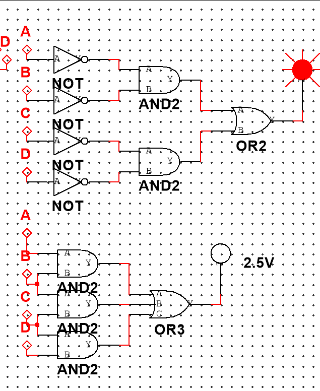
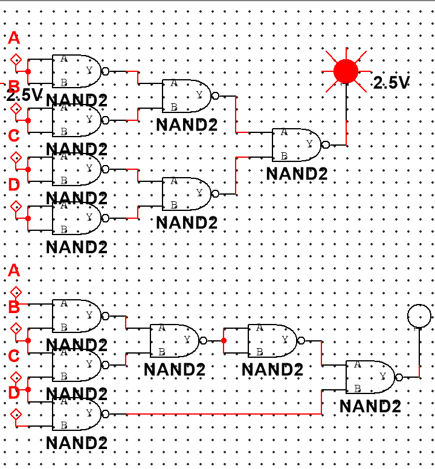
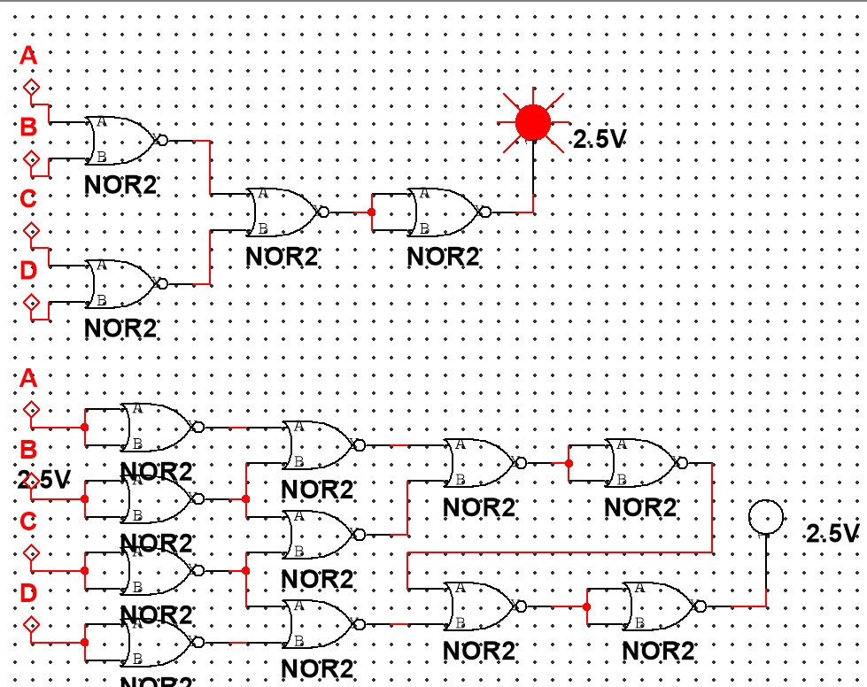
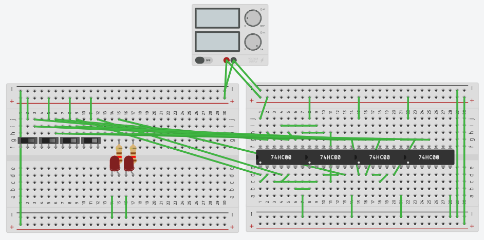
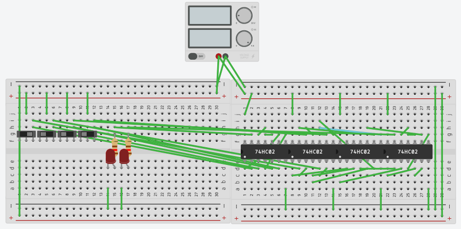
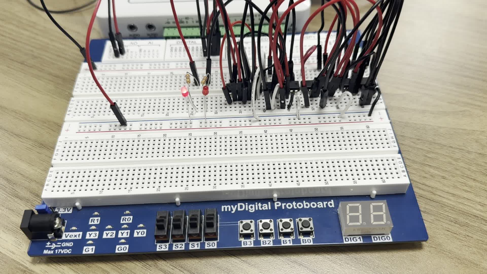
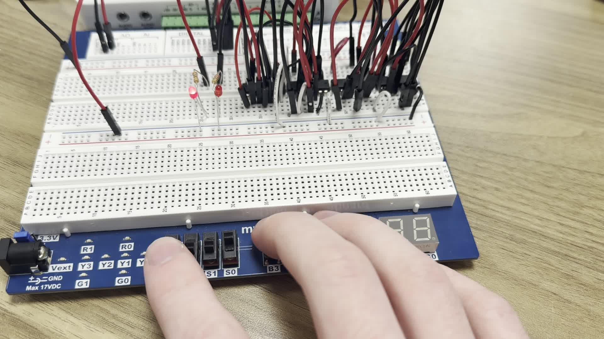

# NAND & NOR
Two universal gates. One voting-booth system.
2.2.2 Universal Gates: NAND / 2.2.3 Universal Gates: NOR
Conner Glover — Digital Electronics — Fall 2026

---
# Four booth inputs control availability and privacy.
HIGH means occupied. Adjacent occupied booths violate privacy.
Booth = complement(A) complement(B) + complement(C) complement(D)
Alarm = AB + BC + CD
Source-derived logic, not measured data. Booth uses the activity's don't-care conditions when privacy is violated.

---
# AOI, NAND, and NOR run side by side in Multisim.

Same recorded frame. Booth is above Alarm in each column.

---
# The NAND layout uses 74HC00 devices.

Four input switches. Two LED indicators.

---
# The NOR layout uses 74HC02 devices.

The same input/output arrangement, rebuilt with NOR gates.

---
# The physical circuit is operated with input switches.

Full demonstration included separately as assets/breadboard-demonstration.mp4.

---
# Both implementations work as intended.

Different gate types implement the same Booth and Alarm functions.
Conner confirmed all teacher-required work is finished and everything works.

---
# RWL: Right, Wrong, Learned

## Right
I completed everything. I never gave up. I did it in this order: Multisim, TinkerCAD, then the breadboard.

## Wrong
I messed up the breadboard several times and restarted whenever I did instead of searching for points of failure.

## Learned
Never give up.
