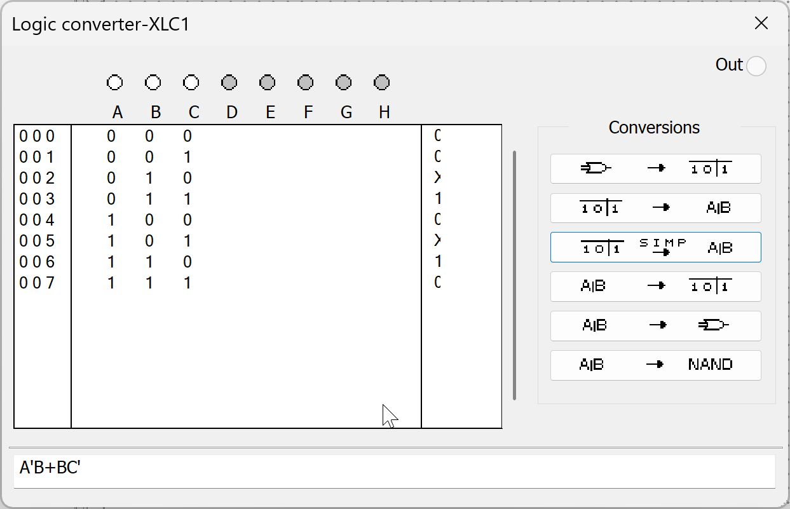
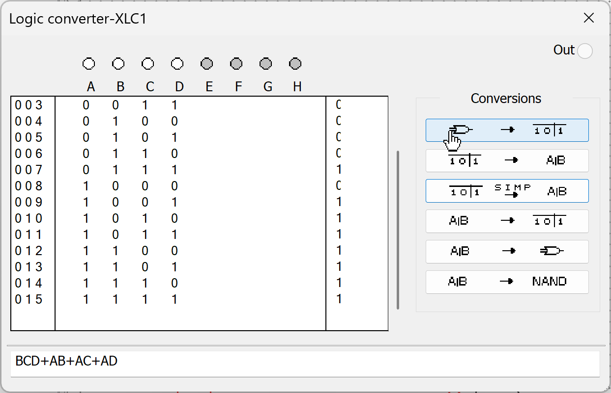
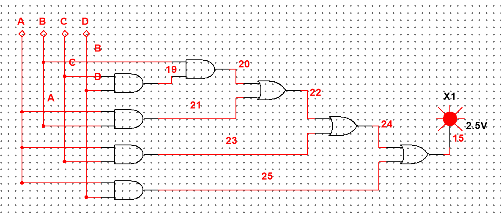
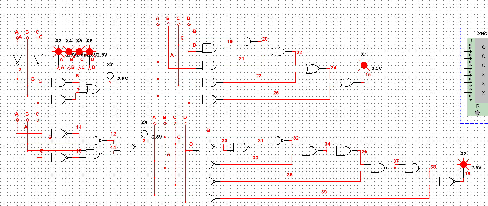
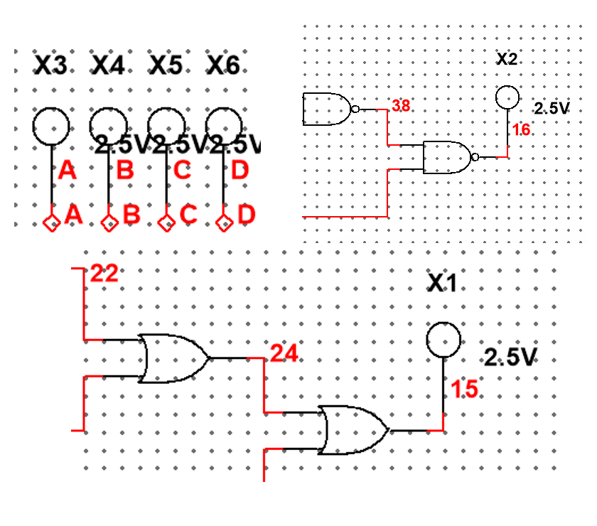
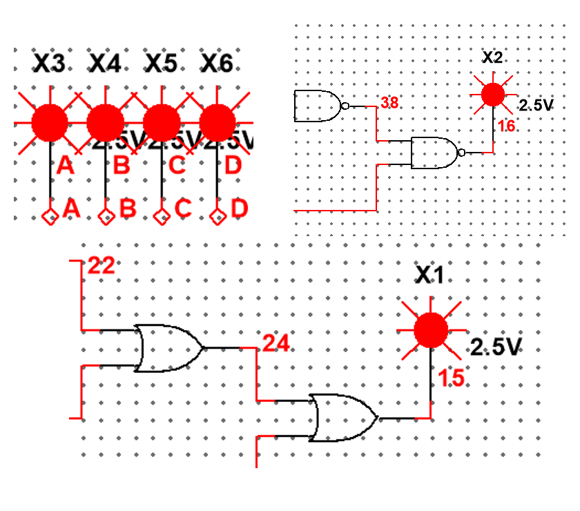

# Logic Converter
2.2.4 Design Tool · Conner Glover · Digital Electronics, Period F

Truth table to logic circuit. One function; AOI and NAND implementations.
Conceptual map: VST, PV, PS, PT feed OR to Vote. Not a recorded circuit.

---
# The three-input expression becomes A'B + BC'.

Before: A'BC + ABC'. After: A'B + BC'. Apostrophe = NOT.
[Original converter screenshot](assets/cir1.png)

---
# The simplification preserves every required output.
Calculated check: all 6 specified rows agree. X = don't-care.
At ABC = 010 the expression changes from 0 to 1, which is permitted.
At ABC = 101 both forms give 0.
This is not a simulation test log.
[Calculated truth check](assets/calculated-truth-check.json)

---
# Majority Vote reduces to four product terms.

A B C D = P V S T. Vote = VST + PV + PS + PT.
Calculated equivalence: 16 of 16 rows match.
HIGH minterms: 7, 9, 10, 11, 12, 13, 14, 15.
[Original unsimplified screenshot](assets/cir2.png)

---
# The recording contains the Majority Vote AOI circuit.

AND paths feed an OR chain. A–D remain displayed input labels.

---
# The recording also contains a NAND-only circuit.

Lower-right: Majority Vote NAND circuit. Upper-right: AOI. Left: three-input example.

---
# Both circuits agree in two recorded states.

Frame 7: ABCD 0000; X1 LOW; X2 LOW.
Frame 85: ABCD 1111; X1 HIGH; X2 HIGH.
Examples do not establish a complete 16-state simulation test.

